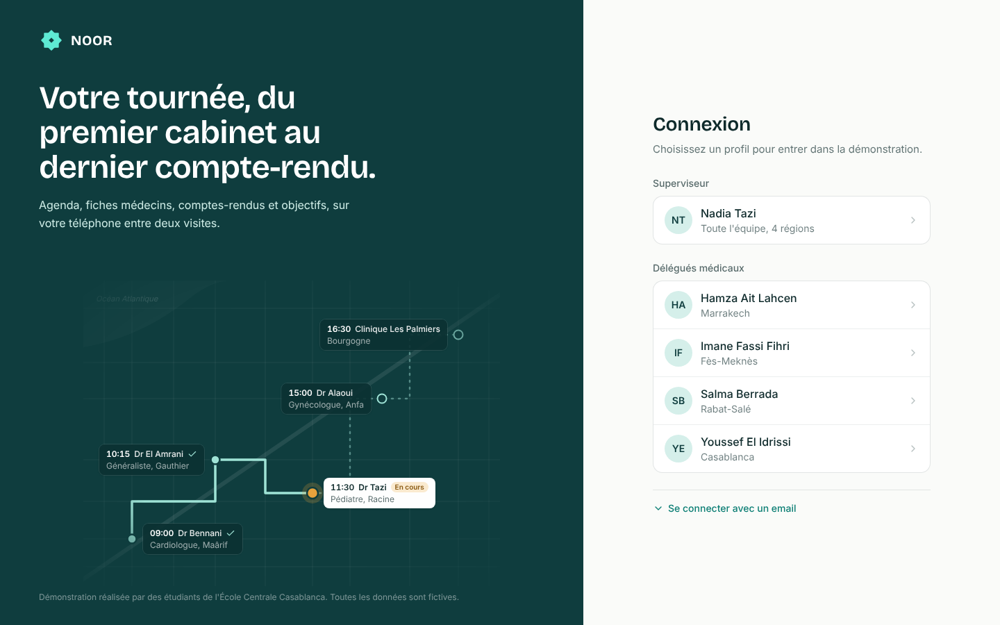
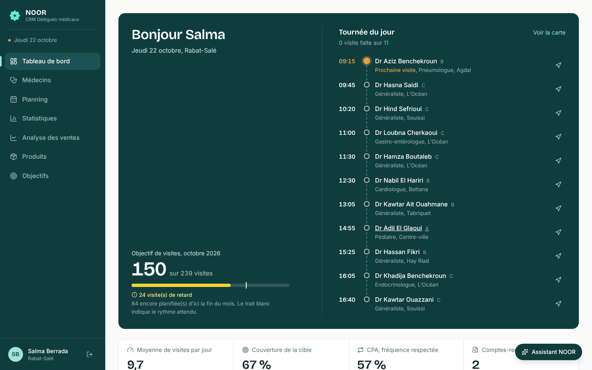
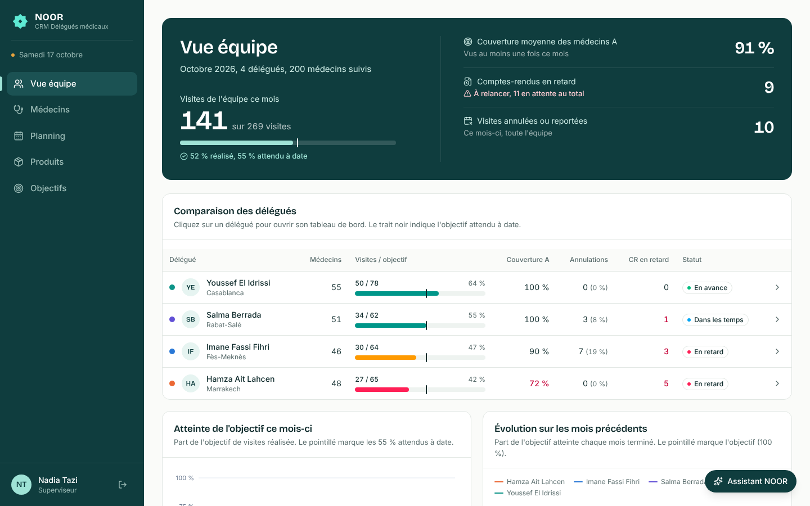
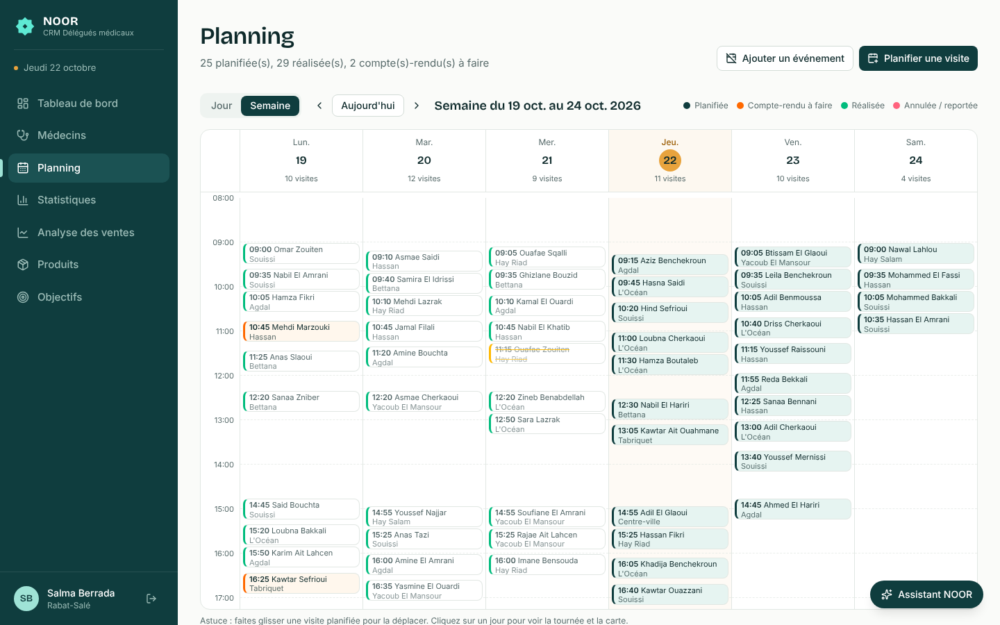
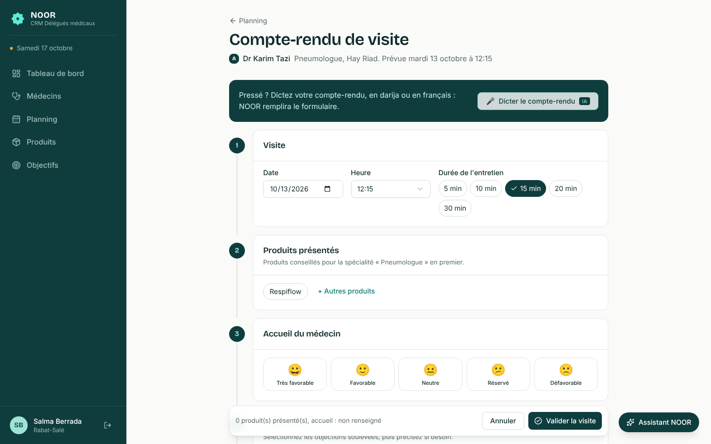
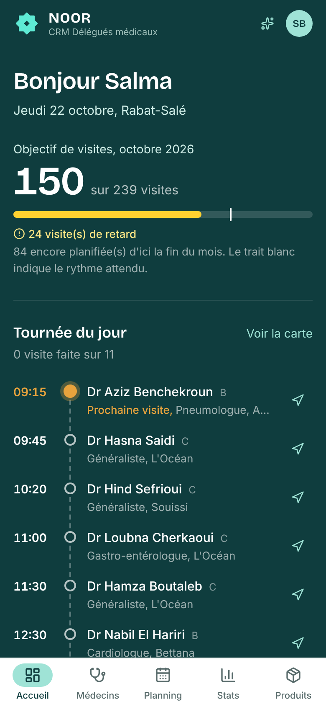
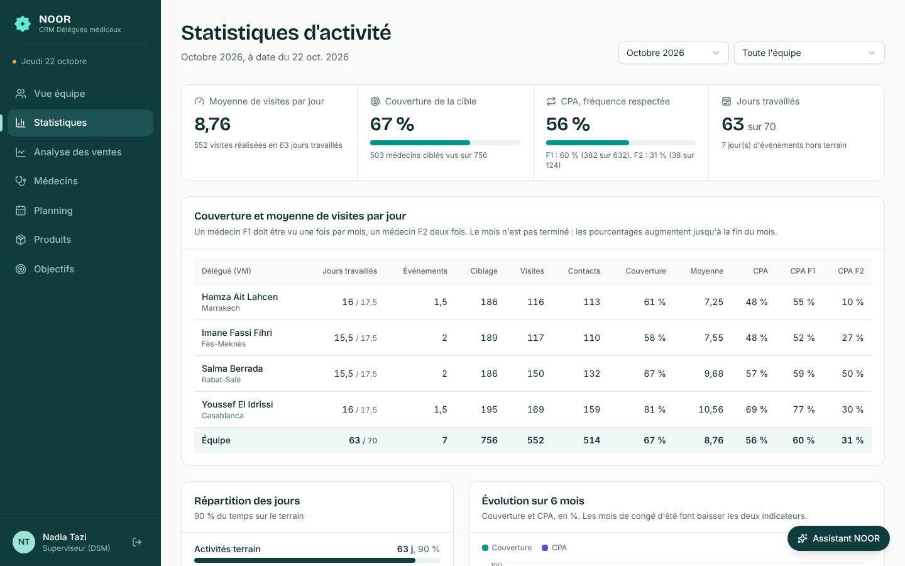
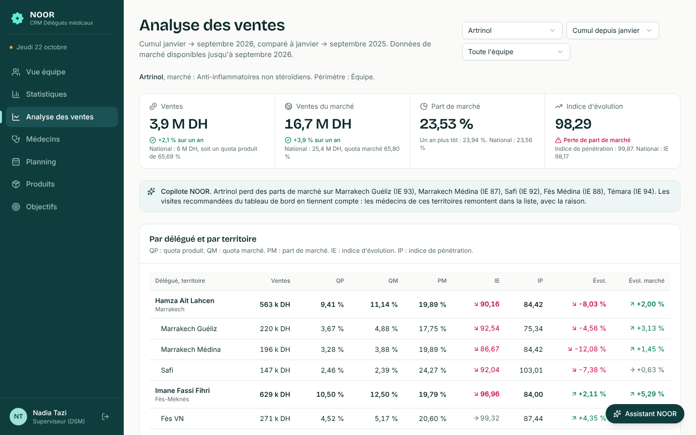

# NOOR Demo — CRM pharmaceutique pour délégués médicaux

Réplique de démonstration d'un CRM pharma de type « NOOR » : les délégués médicaux y
planifient leurs visites chez les médecins, rédigent leurs comptes-rendus et suivent
leurs objectifs ; le superviseur compare son équipe. Les données sont **fictives mais
réalistes** (~860 médecins marocains, ~11 visites par jour et par délégué, 6 mois d'historique,
ventes du marché par territoire), et l'application est conçue
pour accueillir ensuite des **fonctionnalités d'IA** (voir [Points d'extension IA](#points-dextension-ia)).

> Projet d'innovation — École Centrale Casablanca. Les noms de produits sont inventés ;
> les molécules (amlodipine, metformine...) sont réelles.

| Connexion | Tableau de bord délégué | Vue équipe (superviseur) |
|---|---|---|
|  |  |  |
| **Planning** | **Compte-rendu de visite** | **Sur téléphone** |
|  |  |  |
| **Statistiques d'activité** | **Analyse des ventes** | |
|  |  | |

---

## Sommaire

1. [Démarrage rapide](#démarrage-rapide)
2. [Comptes de démo](#comptes-de-démo)
3. [Scénario de démonstration (jury)](#scénario-de-démonstration-jury)
4. [Fonctionnalités](#fonctionnalités)
5. [Architecture](#architecture)
6. [Points d'extension IA](#points-dextension-ia)
7. [Données de démo (seed)](#données-de-démo-seed)
8. [Mise en ligne](#mise-en-ligne)
9. [Dépannage](#dépannage)

---

## Démarrage rapide

Prérequis :
- **Python 3.11, 3.12 ou 3.13** (sous Windows, cocher « Add python.exe to PATH »).
  ⚠️ Pas de version « preview » (3.14+, 3.15) : certains paquets n'y sont pas encore disponibles.
- **Node.js 20+** (version LTS sur https://nodejs.org).
- Git.

```bash
git clone https://github.com/fouad-ghadi/noor-demo.git
cd noor-demo
```

### 1. Backend (terminal 1)

**Windows (PowerShell)**

```powershell
cd backend
py -3.13 -m venv .venv
.venv\Scripts\Activate.ps1          # erreur « exécution de scripts désactivée » ? voir Dépannage
pip install -r requirements.txt
python seed.py                      # crée la base de démo (2 secondes)
uvicorn app.main:app --reload       # API sur http://localhost:8000
```

**macOS / Linux**

```bash
cd backend
python3 -m venv .venv
source .venv/bin/activate
pip install -r requirements.txt
python seed.py
uvicorn app.main:app --reload
```

Documentation interactive de l'API : **http://localhost:8000/docs**

### 2. Frontend (terminal 2)

```bash
cd frontend
npm install                          # la première fois seulement
npm run dev                          # application sur http://localhost:5173
```

Ouvrir **http://localhost:5173**.

**Sur téléphone** : PC et téléphone sur le même Wi-Fi, puis ouvrir l'adresse « Network »
affichée par `npm run dev` (ex. `http://192.168.1.20:5173`).

### Les fois suivantes

```powershell
# terminal 1
cd backend ; .venv\Scripts\Activate.ps1 ; uvicorn app.main:app --reload
# terminal 2
cd frontend ; npm run dev
```

> 💡 Les données sont générées **par rapport à la date du jour** (6 mois d'historique,
> 2 semaines de planning, tournée du jour). Relancez `python seed.py` le matin d'une démo :
> la base est réinitialisée et l'agenda du jour est à jour.

---

## Comptes de démo

Mot de passe de tous les comptes : **`demo`** (ou un clic sur le profil à la connexion).

| Profil | Email | Région | Ce qu'il montre |
|---|---|---|---|
| Superviseur | nadia.tazi@noor-demo.ma | Toutes | Comparaison de l'équipe, tableaux de bord des délégués |
| Délégué | youssef.elidrissi@noor-demo.ma | Casablanca | **En avance** sur ses objectifs, médecins A bien couverts |
| Délégué | salma.berrada@noor-demo.ma | Rabat-Salé | **Dans les temps** |
| Délégué | hamza.aitlahcen@noor-demo.ma | Marrakech | **En retard** : médecins A négligés, comptes-rendus en retard |
| Délégué | imane.fassifihri@noor-demo.ma | Fès-Meknès | **En retard**, beaucoup d'annulations |

Chaque délégué ne voit que **ses** médecins, visites et objectifs ; le superviseur voit toute l'équipe.

---

## Scénario de démonstration (jury)

Durée : 5 à 7 minutes. Lancer `python seed.py` juste avant.

1. **Connexion** — présenter l'écran d'accueil (la tournée du jour d'un délégué), cliquer sur **Hamza**.
2. **Tableau de bord** — « voici ce que voit un délégué le matin sur son téléphone » :
   indicateurs en rouge (visites en retard sur l'objectif, couverture A sous 90 %), comptes-rendus
   en retard, alertes « médecin A non visité depuis 35 jours ».
3. **Médecins à revoir** → cliquer **Planifier** sur un médecin A → choisir demain → la visite apparaît.
4. **Comptes-rendus à rédiger** → **Rédiger** → remplir (produit, accueil 🙂, une objection
   « Prix trop élevé », 2 échantillons) → **Valider**.
   Retour au tableau de bord : **le compteur de visites augmente**, un compte-rendu en attente de moins.
5. **Planning** (vue semaine) — déplacer une visite par glisser-déposer ; vue Jour → carte de la tournée.
6. **Fiche médecin** — statut de prescription par produit, réceptivité par créneau, historique.
7. **Déconnexion → Nadia (superviseur)** — tableau comparatif : Youssef en avance, Hamza en retard ;
   cliquer sur Hamza → son tableau de bord en lecture seule.
8. **Les modules d'IA** (explications pour le jury : [docs/IA_explications_jury.txt](docs/IA_explications_jury.txt)) :
   - **🎤 Dictée** : compte-rendu d'une visite passée → « Dicter le compte-rendu » → « Charger un exemple en darija »
     → « Remplir le formulaire » : le formulaire est pré-rempli, on relit et on valide.
   - **⚠️ Pharmacovigilance** : alertes « Effet indésirable à déclarer » en tête du tableau de bord ; dicter une phrase
     comme « une patiente avec des vertiges sous Cardiovex » crée l'alerte automatiquement à la validation.
   - **💬 Assistant NOOR** : « Peut-on donner Amoxira à un enfant de moins de 6 ans ? » → réponse avec ses sources ;
     « Quel est le prix d'Amoxira ? » → l'assistant dit qu'il ne sait pas (pas dans les documents validés).
   - **✨ Visites recommandées** (tableau de bord) : qui voir, quand, avec quels produits, et pourquoi ;
     le plus parlant avec Hamza (en retard sur ses médecins A).

---

## Fonctionnalités

### Délégué médical (pensé pour le téléphone)

| Écran | Contenu |
|---|---|
| **Tableau de bord** | Agenda du jour ; visites du mois vs objectif (avec repère « attendu à date ») ; moyenne de visites par jour, couverture de la cible, CPA (fréquence respectée), comptes-rendus en attente ; comptes-rendus à rédiger ; visites recommandées ; alertes ; médecins ciblés non vus depuis plus d'un cycle ; objections fréquentes ; visites par semaine (3 mois) |
| **Médecins** | Recherche, filtres (ville, territoire, spécialité, segment, ciblage F1/F2, produit + statut de prescription, dernière visite) ; fiche détaillée ; création / modification |
| **Planning** | Vue semaine (glisser-déposer pour déplacer), vue jour + carte de la tournée (OpenStreetMap) ; planifier, déplacer, annuler, reporter ; événements (réunion, formation, congé...) |
| **Compte-rendu** | Produits présentés (avec rappel des messages clés), durée, accueil du médecin, ce qu'il dit de sa prescription, objections, échantillons avec n° de lot, notes, suite à donner, prochaine visite planifiée automatiquement |
| **Statistiques** | Moyenne de visites par jour, couverture, CPA F1 / F2, jours travaillés et événements, évolution sur 6 mois (formules des rapports d'activité des laboratoires) |
| **Mes performances (ventes)** | Ventes, part de marché, quotas, indices d'évolution et de pénétration par territoire, concurrents (marché type IMS, données fictives) |
| **Produits** | Catalogue, fiche produit (messages clés, indications, documents, statistiques de prescription) |
| **Objectifs** | Mois en cours (visites, couverture A, produits) et historique |

### Superviseur

| Écran | Contenu |
|---|---|
| **Vue équipe** | Totaux de l'équipe ; tableau comparatif des délégués ; atteinte de l'objectif du mois ; évolution mensuelle ; couverture par région et segment ; objections de l'équipe |
| **Statistiques** | Tableau « couverture / moyenne de visites par jour » par délégué (VM) avec la ligne Équipe |
| **Analyse des ventes** | Synthèse de l'équipe par délégué et territoire, comparée au national ; concurrents ; lien avec les visites recommandées |
| **Tableau de bord d'un délégué** | Le même écran que le délégué, en lecture seule |
| Médecins, planning, objectifs | Toute l'équipe, avec un sélecteur de délégué |

---

## Architecture

```
noor-demo/
├── backend/                 API Python (FastAPI + SQLAlchemy + SQLite)
│   ├── seed.py              génère la base de démo (rejouable)
│   ├── noor.db              base SQLite (créée par seed.py, non versionnée)
│   └── app/
│       ├── main.py          point d'entrée FastAPI
│       ├── database.py      connexion SQLite
│       ├── models/          tables (User, Doctor, Product, Visit, Objective, Alert, Document...)
│       ├── schemas/         formats d'entrée / sortie de l'API (Pydantic)
│       ├── services/        ⭐ TOUTE la logique métier (KPIs, alertes, droits d'accès...)
│       ├── api/             routes REST /api/... (fines : elles appellent les services)
│       ├── ai/              ⭐ modules IA (4 implémentés, scan de carte à venir)
│       └── seed_data/       listes utilisées par le seed (noms, quartiers, produits, textes)
├── frontend/                Application web (React + Vite + TypeScript + Tailwind + shadcn/ui)
│   └── src/
│       ├── api/             client HTTP, types, appels IA (ai.ts)
│       ├── auth/            utilisateur connecté (connexion simulée)
│       ├── components/      ui/ (shadcn), layout/, dashboard/, planning/, visits/, assistant/, ai/...
│       ├── hooks/           requêtes partagées (React Query)
│       ├── lib/             dates en français, libellés, couleurs des graphiques
│       └── pages/           un dossier par écran
├── Dockerfile               image de mise en ligne (frontend compilé + API)
├── render.yaml              configuration de l'hébergement Render
├── docs/
│   ├── DEPLOIEMENT.md       guide de mise en ligne
│   ├── products/            PDF des produits (RCP, notices) pour le futur assistant RAG
│   ├── EXTENSIONS_IA.md     guide détaillé pour implémenter chaque module IA
│   └── screenshots/         captures d'écran
└── seed_duplicates.md       (généré par seed.py, non versionné) doublons et comptes-rendus « pharmacovigilance »
```

### Comment circule une requête

```
Navigateur (React)                       Backend (FastAPI)
──────────────────                       ─────────────────────────────────────────────
DashboardPage.tsx
  └─ api.dashboard()  ── GET /api/stats/dashboard ──►  api/stats.py        (lit les paramètres)
     en-tête X-User-Id                                    └─ services/stats_service.py   (calcule)
                                                              ├─ objective_service.py
                                                              ├─ alert_service.py
                                                              └─ SQLAlchemy → noor.db
  ◄── JSON (agenda, KPIs, graphiques, alertes) ───────────
```

Principes :
- **Logique métier dans `services/`, jamais dans les routes.** Les modules IA appellent
  les mêmes fonctions (ex. `visit_service.submit_report`) : droits, alertes et KPIs restent cohérents.
- **Calculs côté serveur.** Le frontend affiche des chiffres déjà calculés.
- **Un délégué ne voit que ses données** : `services/access.py` filtre chaque requête selon
  l'utilisateur (identifié par l'en-tête `X-User-Id` — démo, pas de vraie sécurité).
- **React Query** met en cache les données ; après une modification, les requêtes liées sont
  rechargées (`invalidateVisitData`) : les KPIs se mettent à jour tout seuls.

### Modèle de données (simplifié)

```
User (délégué / superviseur) ──< Doctor ──< DoctorProductStatus >── Product ──< Document
   │                               │                                  │
   ├──< Objective ──< ObjectiveProduct                               MarketProduct ──< SalesRecord
   ├──< Alert                                                      (nos produits + concurrents)
   ├──< Event (réunion, formation, congé...)
   └──< Visit ──< VisitProduct, VisitSample, VisitObjection
```

| Table | Champs clés |
|---|---|
| `doctors` | nom, spécialité, type d'exercice, adresse, ville, quartier, **territoire**, GPS, **segment A/B/C** (potentiel), **fréquence F1/F2** (ciblage ; vide = hors cible), créneau préféré, source (manuel / carte de visite / import), délégué |
| `doctor_product_status` | statut de prescription par produit : non prescripteur / occasionnel / régulier |
| `visits` | date prévue / réelle, statut (planifiée / réalisée / annulée / reportée), durée, accueil, statut de prescription annoncé, notes, suite, prochaine visite, **report_source** (manuel / dictée) ; échantillons avec **n° de lot** |
| `events` | jour, type (réunion d'équipe, formation, congrès, staff, congé, jour férié...), journée ou demi-journée |
| `market_products` · `sales_records` | produits d'un marché (les nôtres et leurs concurrents fictifs) · ventes mensuelles par territoire |
| `objectives` | par délégué et par mois : visites, % de couverture A, présentations par produit |
| `alerts` | type (médecin non visité, objectif en retard, compte-rendu en retard, **pharmacovigilance**), gravité, statut |
| `documents` | RCP / notice / support promotionnel par produit, `file_path` (pour le RAG) |

### API (extraits — liste complète sur http://localhost:8000/docs)

| Méthode | Route | Rôle |
|---|---|---|
| POST | `/api/auth/login` | connexion (mock) |
| GET | `/api/doctors` · `/api/doctors/{id}` | liste filtrée · fiche détaillée |
| POST / PUT | `/api/doctors` · `/api/doctors/{id}` | créer · modifier |
| GET / POST | `/api/visits` | lister (période, statut...) · planifier |
| PATCH | `/api/visits/{id}/reschedule` | déplacer |
| POST | `/api/visits/{id}/cancel` | annuler ou reporter |
| PUT | `/api/visits/{id}/report` | compte-rendu → visite « réalisée » |
| GET | `/api/stats/dashboard` · `/api/stats/team` | tableau de bord délégué · vue équipe |
| GET | `/api/activity` | moyenne de visites par jour, couverture, CPA, jours travaillés (par mois) |
| GET / POST / DELETE | `/api/events` | événements d'agenda |
| GET | `/api/sales` | analyse des ventes (PM, QP, QM, IE, IP, évolution), concurrents |
| GET | `/api/objectives` · `/api/alerts` · `/api/products` | objectifs · alertes · produits |
| * | `/api/ai/...` | fonctionnalités IA (le scan de carte de visite répond 501 : non implémenté) |

---

## Points d'extension IA

Quatre modules d'IA sont **implémentés** ; le cinquième (scan de carte de visite) reste un point d'extension.
Guide détaillé : **[docs/EXTENSIONS_IA.md](docs/EXTENSIONS_IA.md)**. Explications simples pour le jury :
**[docs/IA_explications_jury.txt](docs/IA_explications_jury.txt)**.

| Fonctionnalité | Backend | Route API | Frontend |
|---|---|---|---|
| 🎤 Compte-rendu dicté (darija / français) | `app/ai/voice_report.py` ✅ | `POST /api/ai/voice-report` | fenêtre « Dicter le compte-rendu » — `components/visits/VoiceDictationDialog.tsx` |
| 💬 Assistant produit (RAG + citations) | `app/ai/rag_assistant.py` ✅ | `POST /api/ai/assistant/ask` | panneau « Assistant NOOR » — `components/assistant/AssistantPanel.tsx` |
| ⚠️ Pharmacovigilance | `app/ai/pharmacovigilance.py` ✅ | `POST /api/ai/pharmacovigilance/scan` | alertes du tableau de bord (analyse automatique de chaque compte-rendu) |
| ✨ Recommandations de visites | `app/ai/recommendations.py` ✅ | `GET /api/ai/recommendations` | carte « Visites recommandées » — `components/dashboard/RecommendedVisits.tsx` |
| 📷 Scan de carte de visite + doublons | `app/ai/card_scanner.py` (non implémenté) | `POST /api/ai/card-scanner` (501) | bouton désactivé « Bientôt disponible » — `pages/doctors/DoctorFormPage.tsx` |

**Sans clé d'API, tout fonctionne** (règles, recherche de texte BM25). Avec la variable d'environnement
`ANTHROPIC_API_KEY`, les modules demandent en plus à Claude un résultat de meilleure qualité, et reviennent
aux règles en cas d'erreur (`app/ai/llm.py`). La clé ne doit jamais être écrite dans le code.

- Les documents de l'assistant sont des RCP simplifiés : `docs/products/<Produit>/rcp_<Produit>.md`.
- Évaluation de la pharmacovigilance : `python scripts/evaluer_pharmacovigilance.py` (dans `backend/`).
- La transcription vocale est faite par le navigateur (Chrome) ; le texte reste modifiable.

Les points d'extension sont repérables dans le code par le commentaire `POINT D'EXTENSION IA`.

---

## Données de démo (seed)

`python seed.py` **supprime et recrée** `backend/noor.db`. Le résultat est identique pour un
même jour (hasard « figé »), quelle que soit l'heure.

- **5 utilisateurs** : 1 superviseur, 4 délégués (Casablanca, Rabat-Salé, Marrakech, Fès-Meknès).
- **~860 médecins** (≈ 215 par délégué, dont ≈ 190 ciblés en F1 ou F2) aux noms marocains, dans de vrais
  quartiers regroupés en territoires (Casa Anfa, Rabat Centre, Marrakech Médina, Fès VN...),
  dont **10 quasi-doublons volontaires** (Mohammed El Amrani / Mohamed Elamrani, Ouazzani / Wazzani...).
- **10 produits fictifs** (Cardiovex — amlodipine, Glucanor — metformine, Amoxira — amoxicilline...)
  avec RCP, notice et support promotionnel.
- **~4 900 visites** sur 6 mois : 8 à 12 visites par jour travaillé selon le délégué, médecins F2 vus
  deux fois par mois, créneaux préférés plus réceptifs, annulations, tournées du samedi matin,
  objections réalistes, échantillons avec n° de lot.
- **Événements d'agenda** : jours fériés, congés d'été, réunion d'équipe mensuelle, formations, congrès,
  staff, arrêt maladie (ils réduisent les jours travaillés).
- **Ventes du marché** (type IMS, tout est fictif) : 3 ans de ventes mensuelles par territoire pour nos
  10 produits et 26 concurrents ; certains territoires gagnent des parts de marché, d'autres en perdent.
- **Objectifs mensuels** (délégués en avance / en retard) et **alertes** calculées par les règles métier.
- **7 comptes-rendus mentionnant un effet indésirable** (pour tester la pharmacovigilance).

Les doublons et les comptes-rendus « pharmacovigilance » (avec leurs identifiants) sont listés dans
**`seed_duplicates.md`**, à la racine du projet. Ce fichier est **créé par `python seed.py`** (il n'est
pas dans Git car les identifiants dépendent de la date du seed).

---

## Mise en ligne

Pour que toute l'équipe voie l'application sans rien installer : **[docs/DEPLOIEMENT.md](docs/DEPLOIEMENT.md)**.

- **Render (recommandé)** : adresse fixe, gratuite, mise à jour automatique à chaque `git push`
  (`Dockerfile` + `render.yaml` déjà prêts — 5 minutes de mise en place).
- **Lien temporaire** depuis votre PC : `cloudflared tunnel --url http://localhost:5173`.

---

## Dépannage

| Problème | Solution |
|---|---|
| `git pull` refuse : « Your local changes ... would be overwritten » | `git stash` puis `git pull` (ou `git checkout -- <fichier>` pour annuler la modification locale) |
| Rien n'a changé après un `git pull` | Vérifier avec `git log --oneline -1` ; redémarrer `uvicorn` et `npm run dev` ; recharger la page avec Ctrl+F5 |
| `Microsoft Visual C++ 14.0 is required` / `Failed building wheel` | Version de Python trop récente (preview). Installer Python 3.13, supprimer `backend/.venv`, puis `py -3.13 -m venv .venv` |
| `Activate.ps1 ... l'exécution de scripts est désactivée` | Une fois : `Set-ExecutionPolicy -Scope CurrentUser -ExecutionPolicy RemoteSigned` |
| `npm` / `node` n'est pas reconnu | Installer Node.js LTS (nodejs.org ou `winget install OpenJS.NodeJS.LTS`), **rouvrir** le terminal |
| `uvicorn` n'est pas reconnu | L'environnement n'est pas activé (`.venv\Scripts\Activate.ps1`) ou `pip install` a échoué |
| La page de connexion dit « Le serveur ne répond pas » | Le backend n'est pas lancé (terminal 1) |
| Agenda du jour vide | Normal un dimanche ; sinon relancer `python seed.py` (les données suivent la date du jour) |
| Carte du planning grise | Les fonds de carte OpenStreetMap nécessitent une connexion internet |
| Port déjà utilisé | `uvicorn app.main:app --reload --port 8001` (et modifier le proxy dans `frontend/vite.config.ts`) |

---

## Stack technique

- **Backend** : Python, FastAPI, SQLAlchemy 2, Pydantic 2, SQLite.
- **Frontend** : React 19, Vite, TypeScript, Tailwind CSS 4, composants shadcn/ui (Radix),
  TanStack React Query, React Router, Recharts, Leaflet + OpenStreetMap, date-fns (français).
- **Design** : accent sarcelle, emblème NOOR en étoile à huit branches (« noor » = lumière),
  polices Inter et Bricolage Grotesque ; couleurs des graphiques validées pour les daltoniens.
